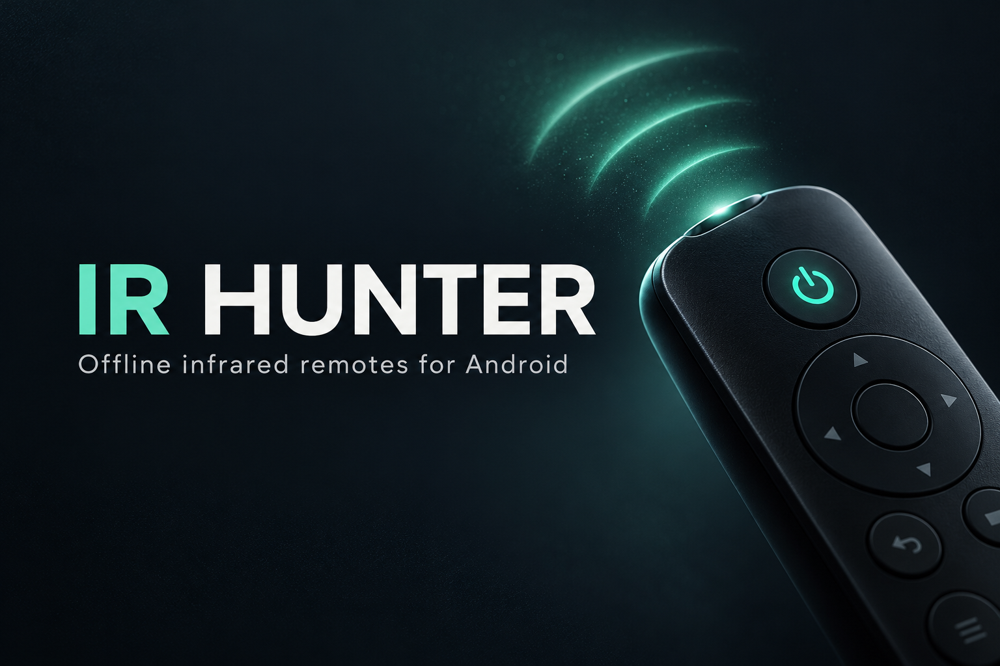

<p align="center">
  
</p>

<h1 align="center">IR Hunter</h1>
<p align="center">Your infrared remotes. Stored on your phone. Ready offline.</p>

<p align="center">
  <a href="https://github.com/n5za/ir-hunter/actions/workflows/android.yml"></a>
  
  
  
</p>

<p align="center">
  <a href="https://github.com/n5za/ir-hunter/releases/tag/v1.0.0-debug"><strong>Download APK</strong></a> ·
  <a href="#installation">Installation</a> ·
  <a href="#getting-started">Getting started</a> ·
  <a href="docs/BUILDING.md">Build from source</a> ·
  <a href="https://github.com/n5za/ir-hunter/issues">Report an issue</a>
</p>

IR Hunter is an Android infrared remote manager built with Kotlin, Jetpack Compose and Room. Import your remote's Flipper `.ir` file, organize its commands, save profiles, and test matching power commands with a cancellable guided scan.

> **Before installing:** transmitting requires a phone with a compatible **built-in IR emitter**. Android version alone is not enough. The app starts with an **empty library**: import device codes before using a remote. The downloadable APK is a **debug test build**; physical IR operation has not yet been verified on hardware.

## What it does

| Feature | Behavior |
| --- | --- |
| Local library | Import Flipper IR signals files; keep source text and attribution on your phone. |
| Search | Filter by category, brand, model or profile name. Unknown brand/model includes all matching profiles. |
| Saved remotes | Save, rename, edit, delete and restore profiles across app restarts. |
| Real command buttons | Show commands contained in the selected profile; no pretend buttons for missing commands. |
| Guided Auto Scan | Test matching imported power candidates with three-second pauses, progress and STOP. Save the candidate after observing a response. |
| All Devices OFF | Select saved devices, review commands, confirm, then transmit sequentially with per-device status and cancellation. |
| Offline operation | Local storage and IR transmission require no account, server or internet permission after import. |
| Hardware feedback | Explain missing emitters, unsupported frequencies and invalid patterns. |

**Categories:** TV · Mi TV / Mi Box · Set-top Box · Air Conditioner · Fan · Smart Box · A/V Receiver · DVD / Blu-ray · Projector · Chinese Satellite · Camera · Other.

A category is an organizational choice, not a device-compatibility guarantee. Bluetooth-only boxes cannot be controlled through Consumer IR. AC captures may represent a full state, so they use manual command testing.

## Installation

### On your phone

1. Open the [v1.0.0-debug release](https://github.com/n5za/ir-hunter/releases/tag/v1.0.0-debug).
2. Download **`IR-Hunter-debug.apk`** from **Assets**. The source ZIP is not the installer.
3. Open the downloaded APK. If Android asks, allow installation from that browser/file manager, then install.
4. Open **IR Hunter**. Check the hardware message, then import your `.ir` remote.

**Requirements:** Android 7.0 / API 24 or newer. A compatible built-in IR emitter is required for transmission; library management also works without one. USB and Bluetooth blasters are not supported.

### Using ADB

With the APK downloaded and your Android device connected with USB debugging enabled:

```sh
adb install -r IR-Hunter-debug.apk
adb shell am start -n com.irhunter.app/.MainActivity
```

If Android reports `INSTALL_FAILED_UPDATE_INCOMPATIBLE`, the installed copy uses a different signing key. Export or keep your original `.ir` files before uninstalling it: uninstalling deletes the local library. CI artifacts are signed with the CI runner's debug key and may not update the release APK in place.

### Verify the download

Download `SHA256SUMS` alongside the APK into the same directory, then run:

```sh
sha256sum -c SHA256SUMS
```

On Windows PowerShell, compare the result with `SHA256SUMS`:

```powershell
Get-FileHash .\IR-Hunter-debug.apk -Algorithm SHA256
```

## Getting started

1. **Import:** choose a category, tap **Import .ir remote**, select a Flipper `IR signals file` version 1, then enter its name and optional brand, model, source and license.
2. **Find:** search your library. Use **Unknown Brand** or **Unknown Model** to clear that filter.
3. **Test:** open a profile, point the phone's emitter at the device, and tap an imported command. “Sent” means the phone submitted the signal; check the appliance yourself.
4. **Save:** tap **Save remote**. The profile appears in Saved and becomes available to All OFF.
5. **Scan when needed:** select the category and filters, then start Auto Scan. Press **STOP** when the target responds and confirm the displayed candidate to save it.
6. **Switch several devices off:** select saved devices in **All OFF**, review the chosen commands and confirm. The app prefers an OFF command you physically verified, then an unverified discrete OFF command, then Power Toggle.

> **Power Toggle can turn an already-off device ON.** Sending an IR command never confirms the target's state. STOP prevents further commands; a single Android IR transmission already in flight cannot be interrupted and is limited to under two seconds. Leaving the foreground cancels the sequence.

## Supported imports

- Flipper `.ir` **IR signals file**, version 1, up to **1 MiB**.
- Parsed protocols: NEC family, Samsung32, RC5 / RC5X / RC6, Sony SIRC family, Kaseikyo, RCA and Pioneer.
- Raw mark/space captures with a supported carrier frequency and valid positive durations.
- Duplicate commands are skipped with warnings; invalid, conflicting or unsupported records are reported.
- Mixed-device `IR library file` databases are not imported as one remote.

No third-party code database is bundled. Import files you are entitled to use; importing a file does not grant redistribution rights. Original comments and attribution remain in local storage.

## Build and verification

```sh
git clone https://github.com/n5za/ir-hunter.git
cd ir-hunter
# Configure JDK 17 and Android SDK as described in docs/BUILDING.md.
./gradlew :app:assembleDebug testDebugUnitTest lintDebug --max-workers=2
```

Output: `app/build/outputs/apk/debug/app-debug.apk`.

The initial release passed **16 automated tests** and Android lint with **zero errors**. Signature, APK integrity, package metadata and ZIP alignment were checked. Dependency-update notices remain. Robolectric covers launch/navigation and database restoration; **installation on an actual device and physical IR transmission remain untested**.

See the [verification report](release/RELEASE_REPORT.md) and [build guide](docs/BUILDING.md). GitHub Actions builds, tests and lints pushes and pull requests, and uploads its APK and reports as workflow artifacts.

## Project layout

```text
app/            Compose screens, navigation and application state
core/model/     Categories, signals, commands and remote profiles
core/ir/        Protocol codecs, validation and Android transmission
core/database/  Room storage and profile serialization
core/data/      Flipper .ir importer
core/scan/      Candidate ordering and cancellable command sequences
docs/           Build guide and README artwork
```

## Contributing and attribution

Read [CONTRIBUTING.md](CONTRIBUTING.md) before submitting changes and [SECURITY.md](SECURITY.md) for vulnerability reporting. Bug and feature-request templates are available in Issues.

The project source currently has **no project-wide license grant**. Publishing the repository does not assign a new license to its pre-existing source. Dependency licenses and source references are documented in [THIRD_PARTY_NOTICES.md](THIRD_PARTY_NOTICES.md); the Apache-2.0 text shipped in app assets applies to the listed third-party dependencies, not automatically to this project.

<sub>The README cover is generated conceptual artwork, not a screenshot of the application.</sub>
